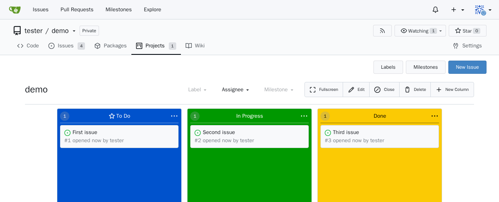
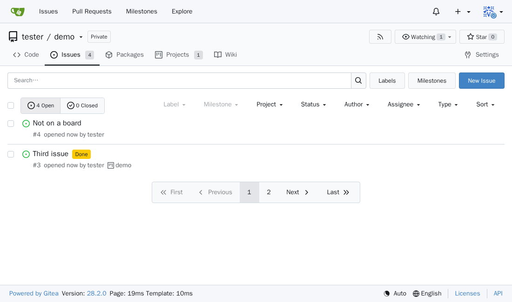
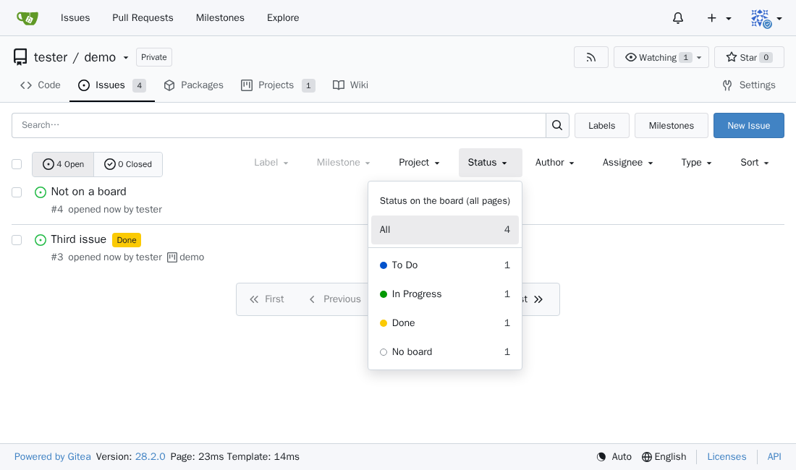
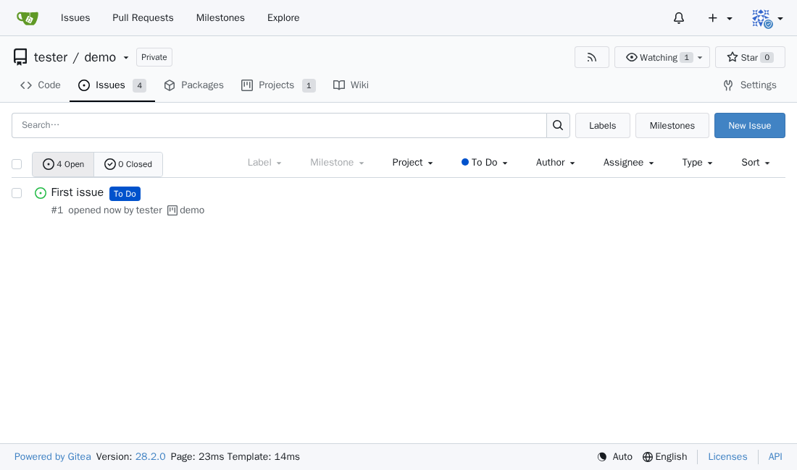
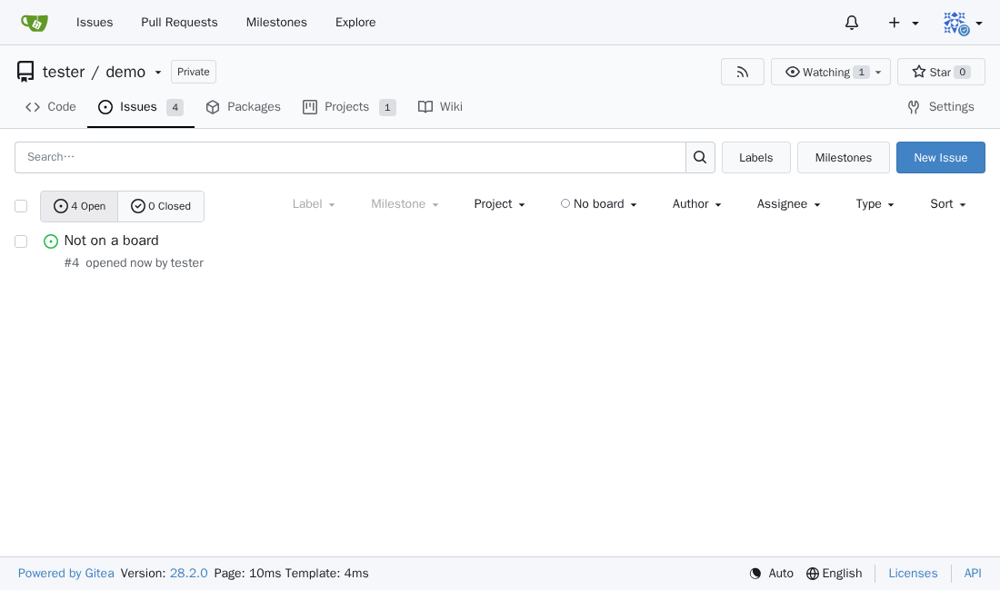
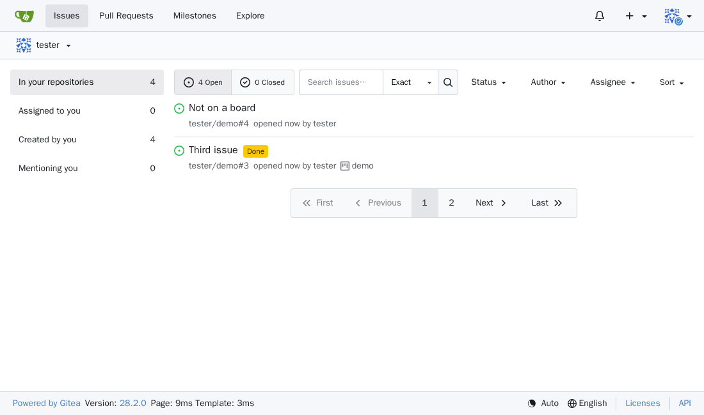
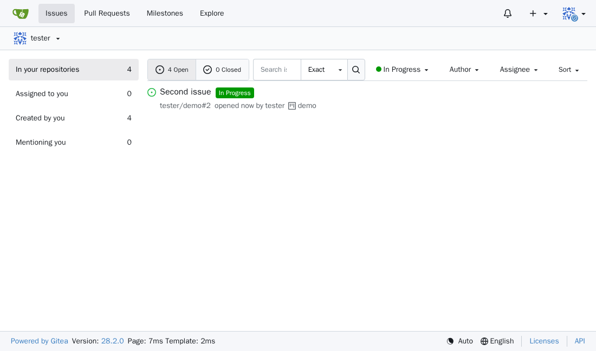
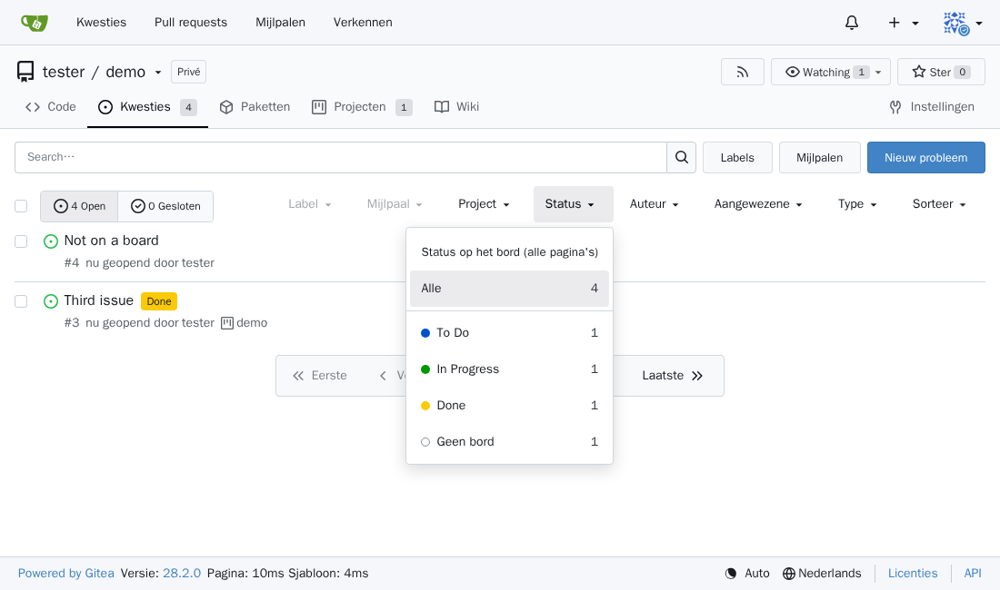

# gitea-board-badges: show project board columns in Gitea's issue list

**Show the project board (kanban) column of every issue and pull request in [Gitea](https://about.gitea.com)'s issue list, and filter issues by board column across all pages.** A drop-in Gitea customization (one template file), no plugin system or Gitea changes needed. Also works with Gitea-based forks that keep Gitea's templates.

Gitea's project boards (kanban: To Do, In Progress, Done …) are great, but the issue list does not tell you where an issue is on the board, and you cannot filter issues by board column. This adds:

- **Badges:** a coloured label with the column name next to every issue on a board, in the colour of that column. Click it to open the board.
- **Status filter:** a *Status* dropdown in Gitea's own filter bar, next to Label, Milestone and Project. Pick a column (or *No board*) and you see every matching issue of the **whole list**, across all pages.

It is a single Gitea template file with a small script: no plugin system, no build step, no changes to Gitea, no external requests.

## Screenshots

### 1. Your project board

A normal Gitea project board. The column names and colours you set here are what the badges and the filter use.



### 2. Badges in the issue list

Every issue that is on the board gets a badge with its column, in the column's colour. Issues on no board get nothing. Gitea's own page buttons stay as they are.



### 3. The Status dropdown

A *Status* dropdown in Gitea's own filter bar, right after *Project*, with the number of issues per column in the **whole list**.



### 4. Filtered across pages

Choosing *To Do* on page 1 shows *First issue*, which Gitea lists on page 2. The page buttons are hidden while a status is selected, and the address ends in `#status=To%20Do`, so you can bookmark or share it.



### 5. Issues on no board

*No board* lists everything that still has to be put on a board.



### 6. The global /issues overview

Badges and the filter also work on `/issues`, across all your repositories.





### 7. In your language

The texts follow the language chosen in Gitea. English and Dutch are included; here in Dutch.



All screenshots are made automatically by the end-to-end test (`test/test.sh`), against a real Gitea.

## How it works

- Works on the issue and pull request lists of a repository and on the global `/issues` overview.
- Reads the repository's project boards with the **visitor's own login and permissions** (Gitea's API does not accept the browser session, the board pages do). It only reads; it never changes anything.
- For the filter it also reads the other pages of the list you are looking at, with the same Gitea filters and sorting (open/closed, labels, search …). Without a status selected you see Gitea's normal page with its page buttons; with a status selected you see all matching issues and the page buttons are hidden. At most 50 pages (1,000 issues with Gitea's default page size) are read.
- The selected status is kept in the URL (`#status=To%20Do`), so a filtered list can be bookmarked or shared.
- Texts follow the language the visitor chose in Gitea: English and Dutch are included. Add a language in the `TEXTS` table at the top of the script.
- If a Gitea update changes the page structure, the script simply adds nothing; Gitea keeps working.

The code is commented in detail; start with the overview at the top of [`footer.tmpl`](footer.tmpl).

## Installation

Put `footer.tmpl` at `$GITEA_CUSTOM/templates/custom/footer.tmpl` and restart Gitea (it reads templates only at startup).

With the official Docker image `$GITEA_CUSTOM` is `/data/gitea`, so you can mount the file read-only:

```yaml
services:
  gitea:
    image: gitea/gitea:latest
    volumes:
      - ./data:/data
      - ./gitea-board-badges/footer.tmpl:/data/gitea/templates/custom/footer.tmpl:ro
```

```sh
docker compose up -d --force-recreate gitea
```

If you already have your own `custom/footer.tmpl`, paste the contents of this file into it.

Tested with Gitea 28.2.0.

## Testing

```sh
test/test.sh                                   # with gitea/gitea:latest
GITEA_IMAGE=gitea/gitea:<version> test/test.sh  # with another version, e.g. before upgrading
```

Needs Docker. The script starts a throwaway Gitea with `footer.tmpl` (set to 2 issues per page, so the list has two pages), creates a repository with four issues and a board (three issues in To Do, In Progress and Done, one on no board) and checks in Chromium (the official Playwright image) that:

- every issue gets the right badge, in the repository list and in `/issues`;
- exactly the other page of the list is fetched;
- the Status dropdown sits next to Project and filters the whole list (also issues on the other page), hides the page buttons while filtering, survives a reload, and works from a link with `#status=`;
- the texts are Dutch for a user who chose Dutch in Gitea.

Screenshots land in `test/out/`. Everything is removed afterwards.

## After a Gitea update

Run `test/test.sh` with the new version first. If it fails, check whether these still exist in Gitea's HTML:

- issue list: `#issue-list > .item`, `a.list-item-large-title`, `.labels-list`, `.page.buttons` (page buttons with `?page=N` links);
- filter bar: `.project-filter` (the dropdown is placed after it) or `.list-header-filters` (on `/issues`); without either, the dropdown gets its own row above the list;
- board page: `.project-column` (colour in `style="background: #…"`), `.project-column-title-text`, `.issue-card`.

## FAQ

**Can Gitea show the project board column (status) of an issue in the issue list?**
Not out of the box: the issue list shows the project, not the column. With gitea-board-badges every issue gets a badge with its column, such as *To Do*, *In Progress* or *Done*.

**How do I filter Gitea issues by project board column / kanban status?**
Install gitea-board-badges and use the *Status* dropdown in the issue list's filter bar. It filters the whole list, not just the current page, and the choice is kept in the URL.

**Does it need a Gitea plugin, API token or extra server?**
No. It is one template file that Gitea includes in every page. It reads the board pages with the visitor's own login, only reads, and talks to nothing but your own Gitea.

**Does it work with private repositories?**
Yes. Every visitor only sees badges for boards they are allowed to see.

**Which Gitea versions are supported?**
Tested with Gitea 28.2.0. Run `test/test.sh` with `GITEA_IMAGE=gitea/gitea:<version>` to check another version before upgrading.

**Can I change the texts or add a language?**
Yes, in the `TEXTS` table at the top of the script. English and Dutch are included.

## License

[MIT](LICENSE) © Giovanni Vandewaetere

---

**Nederlands:** toont in Gitea naast elk ticket de kolom van het projectbord (To Do, In Progress, Done …) als gekleurd label, en voegt in de filterbalk een keuzelijst *Status* toe die de volledige lijst filtert, over alle pagina's heen. Het is één template-bestand voor Gitea; installatie en tests staan hierboven. De teksten volgen de taal die je in Gitea gekozen hebt.
